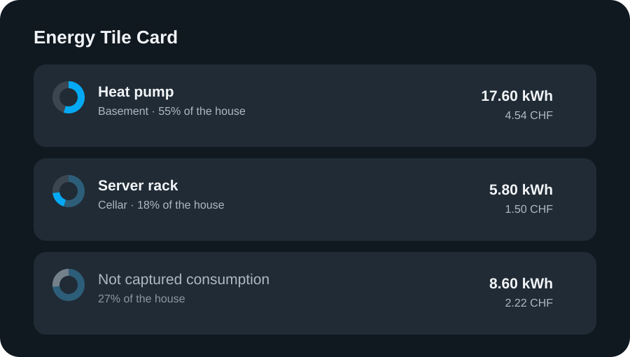

# HA Energy Tile Card

A Home Assistant dashboard card for energy consumption, costs, and percentage-based consumption shares.



## Features

- Reads one recorder-calculated total per entity for the active Energy dashboard period
- Refreshes active periods when Home Assistant generates new five-minute statistics
- Displays all visible energy sensors with an optional exclusion list
- Includes a built-in visual card editor
- Narrows the visual price-entity picker to monetary sensors and validates `/kWh` units
- Displays consumption and optional costs next to a ring that shows the share of the whole house consumption
- Draws each ring where the previous one ended, so the rings together form the circle of the house consumption
- Adds one row for the part of the house consumption that no listed sensor covers, named in the language of the Home Assistant user
- Supports `Wh`, `kWh`, and `MWh`
- Opens the entity's more-info dialog when selected

## Requirements

- Home Assistant with an Energy dashboard and recorder statistics
- Energy sensors using `device_class: energy`
- A unit of `Wh`, `kWh`, or `MWh`
- `state_class: total` or `total_increasing`

## HACS installation

[](https://my.home-assistant.io/redirect/hacs_repository/?owner=psym88&repository=ha_energy-tile-card&category=plugin)

1. Open HACS and select **Custom repositories** from the three-dot menu.
2. Add `https://github.com/psym88/ha_energy-tile-card` with the **Dashboard** category.
3. Install **HA Energy Tile Card**.
4. Reload Home Assistant and clear the browser cache if necessary.

HACS normally registers this resource automatically:

```text
/hacsfiles/ha_energy-tile-card/ha_energy-tile-card.js?hacstag=…
```

The HACS-generated `hacstag` value identifies the installed revision and changes after an update to invalidate browser caches. Keep the JavaScript filename stable; HACS manages the version parameter.

If the resource is missing, add `/hacsfiles/ha_energy-tile-card/ha_energy-tile-card.js` as a JavaScript module under **Settings → Dashboards → Resources**.

## Configuration

> **Breaking change in v1.0.4:** Replace `custom:energy-tile-card` with `custom:ha_energy-tile-card` in existing dashboards.
>
> **Breaking change in v2.0.0:** `entity`, `entities`, and `include_all_energy` are no longer supported. The card always discovers visible Energy sensors and uses `exclude_entities` to hide individual sensors.
>
> **Breaking change in v2.3.0:** Each row shows a consumption ring instead of an icon and a percentage bar, so `icon` no longer has any effect.

Display all visible energy sensors:

```yaml
type: custom:ha_energy-tile-card
collection_key: energy_1
display_unit: kWh
show_zero: false
tap_action:
  action: more-info
```

Exclude selected sensors and display the current price per kWh:

```yaml
type: custom:ha_energy-tile-card
collection_key: energy_1
exclude_entities:
  - sensor.washing_machine_energy
  - sensor.dryer_energy
price_entity: sensor.electricity_price
currency: CHF
display_unit: kWh
name:
  - area
  - entity
state_content:
  - state
show_zero: false
show_untracked: true
untracked_name: Not captured consumption
```

| Option | Required | Default | Description |
| --- | --- | --- | --- |
| `collection_key` | Yes | – | Energy data collection key, for example `energy_1` |
| `exclude_entities` | No | Empty | Energy sensors that should not be displayed |
| `price_entity` | No | – | Entity containing the current price with a unit ending in `/kWh` |
| `currency` | No | Home Assistant currency | Optional YAML override for Home Assistant's configured currency |
| `display_unit` | No | `kWh` | `Wh`, `kWh`, or `MWh` |
| `show_zero` | No | `true` | Whether to include sensors without consumption |
| `show_untracked` | No | `true` | Adds a row for the part of the house consumption no listed sensor covers |
| `untracked_name` | No | Label of the user's language | Name of that row, English where the language is not translated |
| `name` | No | `entity` | Name parts: `entity`, `device`, `area`, `floor` |
| `state_content` | No | `state` | Secondary content: `state`, `device_name`, `area_name`, `floor_name` |
| `tap_action.action` | No | `more-info` | `more-info` or `none` |

## Consumption rings

Every row carries a ring instead of an icon. A ring is a slice of one shared circle: the whole circle is the house consumption of the selected period, a slice is as wide as the device is large, and each slice starts where the previous one ended. The card reads the house consumption from the Energy collection named by `collection_key`, the same source the Energy dashboard uses: the configured home meter if there is one, otherwise the grid import plus solar and battery discharge that stayed in the house.

What the listed sensors do not account for is shown as one additional row, `Not captured consumption`, so the circle is always complete. Its name follows the language of the Home Assistant user, English where that language is not translated, and `untracked_name` replaces it in any language. Set `show_untracked: false` to leave the row out. When the dashboard has no consumption sources for the period, the card can only measure against the listed sensors: the rings then show the share within the list and the extra row stays away.

## Home Assistant settings

The card automatically uses Home Assistant's configured currency, the active user's language and number format, and Home Assistant's entity name and state formatters. These locale-dependent values do not appear in the visual editor and require no card configuration. The optional YAML `currency` value remains available only as a backward-compatible override.

## Manual installation

Copy `ha_energy-tile-card.js` to `/config/www/ha_energy-tile-card.js`, then register `/local/ha_energy-tile-card.js` as a JavaScript module.

## Development

```bash
npm run check
npm test
```

Edit `ha_energy-tile-card.js` directly. The card is intentionally kept as a single dependency-free file and requires no build step.

## Language policy

Repository code, comments, user-facing strings, documentation, examples, release notes, and commit messages must be written in English. See [AGENTS.md](AGENTS.md).

## License

[MIT](LICENSE)
